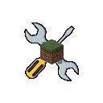

<div align="center">



# Vanilla Overrides

[](https://modrinth.com/mods?e=server)
[](https://minecraft.net)

A lightweight **Fabric** mod for **Minecraft 26.3** that adds configurable rules to override vanilla behaviors in a clean and controlled way.

</div>

---

## Features

- Villagers can be leashed


## Commands

The main command is:

```
/overrides
```

Examples:

```
/overrides villagerLeads          → Shows the current value
/overrides villagerLeads true     → Enables the rule
/overrides villagerLeads false    → Disables the rule
```

## Configuration

Settings are stored in:

```
config/vanillaoverrides.json
```

You can edit the file manually or change values using commands. Changes are saved automatically.

## Installation

1. Install [Fabric Loader](https://fabricmc.net/use/) for Minecraft **26.3**
2. Install [Fabric API](https://modrinth.com/mod/fabric-api)
3. Place the mod `.jar` into your `mods` folder
4. Launch the game

## Suggestions

Suggestions for new rules and improvements are welcome!  
Feel free to open an issue or share your ideas.

## License

[GNU Lesser General Public License](LICENSE), version 3.0.